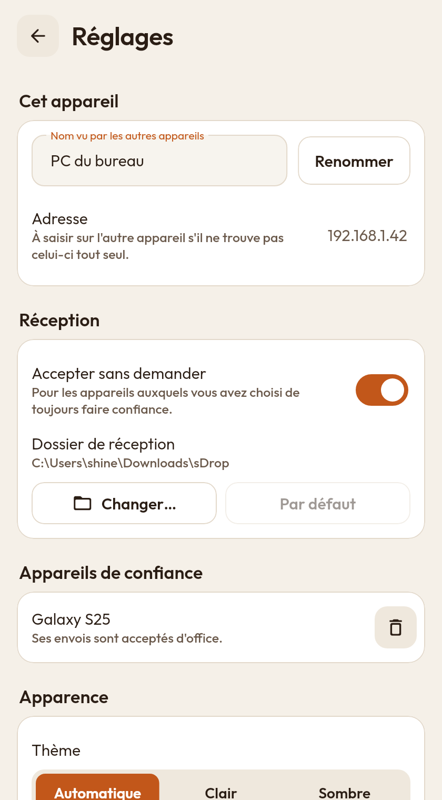

<p align="center"></p>

# sDrop

Envoyer un fichier, des photos ou un texte du téléphone au PC, et du PC au téléphone, en
un geste. Les appareils se trouvent tout seuls sur le Wi-Fi de la maison : pas de câble,
pas de compte, rien ne passe par Internet.

<p align="center">
  <a href="https://github.com/ShinezeoGame/sDrop/releases/latest/download/sdrop.apk"></a>
  <a href="https://github.com/ShinezeoGame/sDrop/releases/latest/download/sdrop-setup.exe"></a>
</p>

<p align="center">
  
  
  
</p>

## Fonctionnalités

- **La même application sur le téléphone (Android) et sur le PC (Windows)** : chacune voit
  l'autre dès qu'elles sont ouvertes sur le même réseau.
- **Fichiers, photos, texte** : choisissez l'appareil, puis ce que vous envoyez. Un lien ou
  un texte reçu se copie d'un clic.
- **Depuis n'importe quelle application du téléphone** : sDrop apparaît dans le menu
  « Partager » d'Android.
- **Glisser-déposer sur le PC** : déposez des fichiers dans la fenêtre, puis cliquez sur
  l'appareil destinataire.
- **Rien n'arrive sans votre accord** : chaque envoi est à accepter ou refuser. Cochez
  « Toujours accepter cet appareil » pour vos propres appareils, et les envois suivants
  arrivent tout seuls.
- **Suivi** : avancement en direct, annulation en cours de route, liste des derniers transferts.
- **Thème clair ou sombre**, dans le même style que [sDash](https://github.com/ShinezeoGame/sDash)
  et [sPhone](https://github.com/ShinezeoGame/sPhone).

Les fichiers reçus sont rangés dans `Téléchargements\sDrop` (sur Android : `Download/sDrop`).
Un fichier du même nom n'est jamais écrasé.

## Installation

- **Téléphone** : téléchargez `sdrop.apk`, ouvrez-le et autorisez l'installation
  d'applications de sources inconnues si Android le demande. Android 11 au minimum.
- **PC** : téléchargez `sdrop-setup.exe` et lancez-le. L'application n'est pas signée : si
  Windows affiche « Windows a protégé votre ordinateur », cliquez sur « Informations
  complémentaires » puis « Exécuter quand même ». **Au premier lancement, autorisez sDrop
  sur les réseaux privés** quand le pare-feu Windows le demande : sans cela, le PC ne peut
  ni être vu ni recevoir.

Les compilations de chaque branche sont disponibles en artefacts **sdrop-android** et
**sdrop-windows** dans l'onglet **Actions**.

## Utilisation

1. Ouvrez sDrop sur les deux appareils, connectés au même Wi-Fi. Ils apparaissent l'un
   chez l'autre en quelques secondes.
2. Sur celui qui envoie, choisissez **Fichiers**, **Photos** ou **Texte** sous le nom du
   destinataire.
3. Sur celui qui reçoit, **Acceptez**.

L'application doit être ouverte sur l'appareil qui reçoit.

| Souci | Solution |
| --- | --- |
| Les appareils ne se voient pas | Vérifiez qu'ils sont sur le même Wi-Fi (pas le réseau « invités » de la box). Sur le PC, vérifiez que sDrop est autorisé dans le pare-feu pour les réseaux privés. |
| Toujours rien | **Ajouter par adresse** : saisissez sur un appareil l'adresse affichée dans les réglages de sDrop de l'autre. |
| Les fichiers reçus sont introuvables sur le téléphone | Ils sont dans l'application Mes fichiers → Téléchargements → sDrop. |

## Confidentialité et sécurité

Les envois vont directement d'un appareil à l'autre sur le réseau local. Ils ne sont
**pas chiffrés** : quelqu'un qui écouterait votre réseau pourrait les lire. N'utilisez
sDrop que sur un réseau de confiance, comme celui de la maison, pas sur un Wi-Fi public.

Un appareil du réseau ne peut rien déposer chez vous sans que vous l'acceptiez. La
confiance accordée à un appareil repose sur un jeton secret qui lui est remis, pas sur son
nom ; vous la retirez dans les réglages.

## Comment ça marche

sDrop est une application [Flutter](https://flutter.dev), avec le même code pour Android
et Windows.

- **Découverte** : chaque appareil annonce son nom toutes les quelques secondes par un
  petit message UDP (multidiffusion et diffusion), et se signale directement à ceux qu'il
  entend. Il suffit donc que les annonces passent dans un sens.
- **Envoi** : l'expéditeur demande l'accord du destinataire (HTTP sur le réseau local,
  port 47873), puis lui transmet les fichiers un par un.

## Développement

Flutter 3.47. Pour Windows, Visual Studio avec la charge « Développement Desktop en C++ » ;
pour Android, le SDK Android.

```powershell
flutter run -d windows
```

- Vérifications : `flutter analyze` et `flutter test`. Les tests font dialoguer deux
  appareils sDrop réels sur la même machine (découverte, envoi, refus, confiance,
  annulation) : ni téléphone ni second ordinateur nécessaires.
- `.github/workflows/build.yml` teste, compile l'APK et l'application Windows (qu'il lance
  et interroge pour de bon), et publie la version à chaque envoi sur `main`.
- Clé de signature Android (facultative, pour que les mises à jour s'installent par-dessus
  l'ancienne version) : secrets `ANDROID_KEYSTORE_BASE64` et `ANDROID_KEYSTORE_PASSWORD`
  du dépôt, comme pour sDash.

## Logo

sDrop partage sa marque avec sDash et sPhone : le même carré orange, le même trait clair,
et le même point ambre, toujours au même endroit. Seul le dessin change — ici une flèche
qui tombe dans un bac. Les sources vectorielles sont dans `docs/logo/` ;
`tools/logo/generer_logo.py` les produit, `tools/logo/exporter.py` en tire les PNG et les
icônes Windows et Android.

## Licences

Police [Outfit](https://github.com/Outfitio/Outfit-Fonts) sous licence SIL Open Font License 1.1
(`assets/fonts/OFL.txt`).
