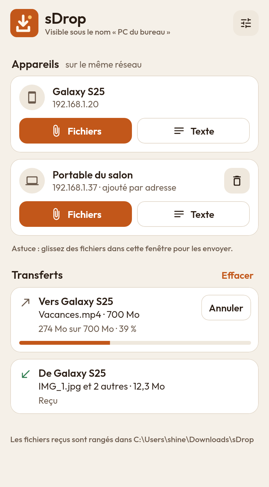
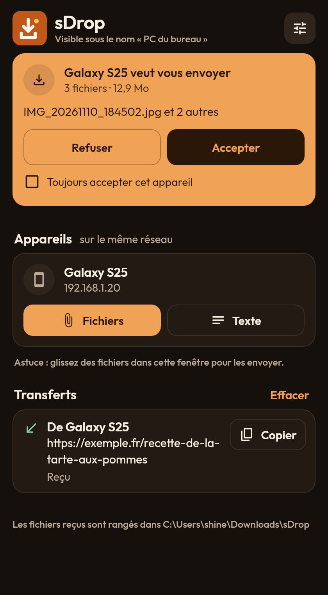
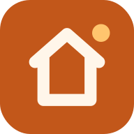

<h1 align="center">sDrop</h1>

<b>Du téléphone au PC, et du PC au téléphone. En un geste, sans câble.</b>

  
  
  

Les photos de la journée à mettre sur le PC, un document à garder sur le téléphone, un lien
à ouvrir sur le grand écran : avec sDrop, vous choisissez l'appareil, vous choisissez quoi
envoyer, et c'est arrivé. Vos appareils se trouvent tout seuls sur le Wi-Fi de la maison.
Pas de câble, pas de compte, rien ne passe par Internet.

  
  
  

## Pourquoi sDrop

- **Fini le câble et les envois à soi-même.** Plus besoin de vous écrire un e-mail ou un
  message pour récupérer un fichier : il va directement d'un appareil à l'autre.
- **La même appli des deux côtés.** Sur le téléphone Android comme sur le PC Windows, sDrop
  a la même allure et s'utilise de la même façon.
- **Vous gardez la main.** Rien n'arrive sur un appareil sans votre accord, et rien ne quitte
  votre réseau.

## Ce que fait sDrop

### 📁 Fichiers et photos
Choisissez un ou plusieurs fichiers, ou piochez dans vos photos, puis envoyez-les à
l'appareil de votre choix. Ils arrivent dans le dossier Téléchargements, rangés dans
`sDrop`, et un fichier du même nom n'est jamais écrasé.

### 💬 Textes et liens
Envoyez un texte ou un lien d'un appareil à l'autre. À l'arrivée, un clic le copie, prêt à
être collé où vous voulez.

### 📤 Depuis n'importe quelle appli du téléphone
sDrop apparaît dans le menu « Partager » d'Android : une photo dans la galerie, un document,
une page web… partagez-les vers sDrop et choisissez le PC.

### 🖱️ Glisser-déposer sur le PC
Déposez des fichiers dans la fenêtre de sDrop, cliquez sur le téléphone : c'est parti.

### ✋ Rien n'arrive sans votre accord
Chaque envoi s'affiche d'abord comme une demande, à accepter ou refuser. Pour vos propres
appareils, cochez « Toujours accepter cet appareil » : les envois suivants arrivent tout
seuls, et vous pouvez retirer cette confiance à tout moment dans les réglages.

### 📊 Suivi en direct
L'avancement s'affiche pendant l'envoi, un transfert peut être annulé en cours de route, et
la liste des derniers transferts reste sous la main.

### 📶 Vos appareils se trouvent tout seuls
Ouvrez sDrop sur le téléphone et le PC connectés au même Wi-Fi : ils apparaissent l'un chez
l'autre, sans rien configurer. Si votre réseau bloque cette découverte, vous pouvez ajouter
un appareil par son adresse.

### 🌗 Clair ou sombre
Un thème clair et un thème sombre, au choix ou selon le système.

## Prise en main

1. **Installez** sDrop sur le téléphone et sur le PC avec les boutons en haut de cette page.
2. **Ouvrez-le** des deux côtés, sur le même Wi-Fi : chaque appareil voit l'autre.
3. **Envoyez** : sous le nom du destinataire, choisissez Fichiers, Photos ou Texte, puis
   acceptez la demande sur l'appareil qui reçoit.

Le [guide d'utilisation](docs/GUIDE.md) détaille l'installation, le pare-feu Windows,
l'ajout par adresse et les solutions aux soucis courants.

## Questions fréquentes

**Faut-il un compte ou un abonnement ?** Non. sDrop est gratuit, sans compte, sans
publicité.

**Mes fichiers passent-ils par Internet ?** Non. Ils vont directement d'un appareil à
l'autre, sur votre réseau local. Aucun serveur, aucun nuage.

**Avec quels appareils ?** Les téléphones et tablettes Android 11 ou plus récents, et les PC
sous Windows. sDrop a été pensé autour d'un Samsung Galaxy S25.

**Est-ce sécurisé ?** Personne ne peut déposer un fichier chez vous sans votre accord, et la
confiance accordée à un appareil repose sur un jeton secret, pas sur son nom. En revanche,
les envois ne sont **pas chiffrés** : quelqu'un qui écouterait votre réseau pourrait les
lire. Utilisez sDrop sur un réseau de confiance, comme celui de la maison, pas sur un Wi-Fi
public.

## La famille sPack

sDrop fait partie de **sPack**, une famille d'applications pratiques pour la maison, toutes
dans le même style.

| | | | |
| :---: | :---: | :---: | :---: |
|  |  |  |  |
| **[sDash](https://github.com/ShinezeoGame/sDash)** Toute la maison sur une tablette | **[sPhone](https://github.com/ShinezeoGame/sPhone)** L'écran du téléphone sur le PC | **sDrop** Fichiers et textes entre téléphone et PC | **[sPing](https://github.com/ShinezeoGame/sPing)** Les notifications du téléphone sur le PC |
|  |  |  |   |
| **[sWatt](https://github.com/ShinezeoGame/sWatt)** La consommation électrique de la maison bientôt | **[sCam](https://github.com/ShinezeoGame/sCam)** Un vieux téléphone en caméra ou babyphone bientôt | **[sBackup](https://github.com/ShinezeoGame/sBackup)** Les photos du téléphone sauvegardées sur le NAS bientôt |   |

---

Fonctionnement, développement et logo : voir [docs/DEVELOPPEMENT.md](docs/DEVELOPPEMENT.md).
Police [Outfit](https://github.com/Outfitio/Outfit-Fonts) sous licence SIL Open Font License 1.1.
