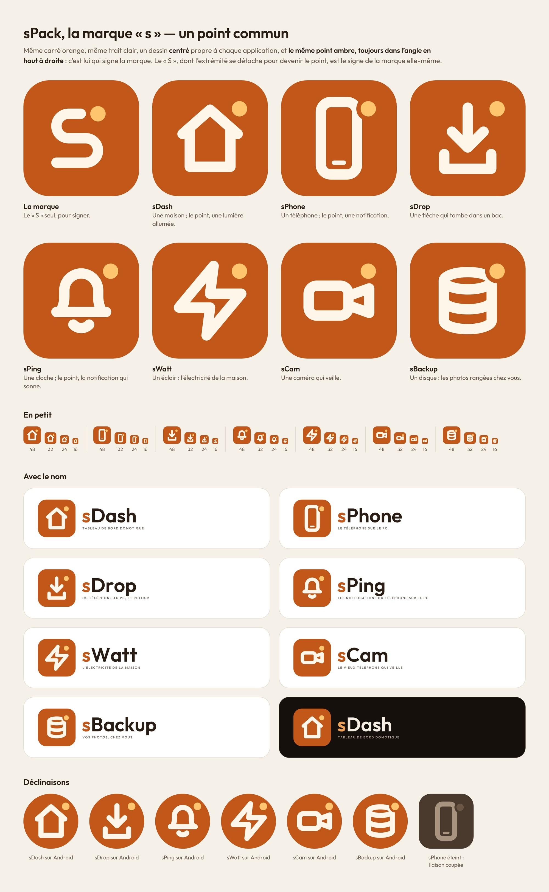

[← Retour à la présentation](../README.md)

# sDrop : fonctionnement et développement

## Comment ça marche

sDrop est une application [Flutter](https://flutter.dev), avec le même code pour Android
et Windows.

- **Découverte** : chaque appareil annonce son nom toutes les quelques secondes par un
  petit message UDP (multidiffusion et diffusion), et se signale directement à ceux qu'il
  entend. Il suffit donc que les annonces passent dans un sens.
- **Envoi** : l'expéditeur demande l'accord du destinataire (HTTP sur le réseau local,
  port 47873), puis lui transmet les fichiers un par un.

Les échanges ne sont pas chiffrés ; voir [Confidentialité et sécurité](GUIDE.md#confidentialité-et-sécurité).

## Développement

Flutter 3.47. Pour Windows, Visual Studio avec la charge « Développement Desktop en C++ » ;
pour Android, le SDK Android.

```powershell
flutter run -d windows
```

- Vérifications : `flutter analyze` et `flutter test`. Les tests font dialoguer deux
  appareils sDrop réels sur la même machine (découverte, envoi, refus, confiance,
  annulation) : ni téléphone ni second ordinateur nécessaires.
- Captures de la documentation : `SDROP_CAPTURES=1 flutter test test/captures_test.dart`.
- `.github/workflows/build.yml` teste, compile l'APK et l'application Windows (qu'il lance
  et interroge pour de bon), et publie la version à chaque envoi sur `main` ou à la demande
  (bouton « Run workflow », case « Publier »). Un changement qui ne touche que la
  documentation (`.md`, `docs/`) ne déclenche ni compilation ni publication.
- Clé de signature Android (facultative, pour que les mises à jour s'installent par-dessus
  l'ancienne version) : secrets `ANDROID_KEYSTORE_BASE64` et `ANDROID_KEYSTORE_PASSWORD`
  du dépôt, comme pour sDash.

## Logo

sDrop partage sa marque avec les autres applications de la famille sPack (sDash, sPhone,
sPing, sWatt, sCam, sBackup) : le même carré orange, le même trait clair, et le même point
ambre, toujours au même endroit. Seul le dessin change — ici une flèche qui tombe dans un
bac.



Les sources vectorielles sont dans `docs/logo/` ;
`tools/logo/generer_logo.py` les produit, `tools/logo/exporter.py` en tire les PNG et les
icônes Windows et Android. `generer_logo.py` est identique dans tous les dépôts de sPack,
seule `APPLI_DU_DEPOT` diffère : le modifier dans l'un, c'est le recopier dans les autres.
Les icônes de la famille (`docs/logo/famille/`) sont produites par le même générateur
(`generer_logo.py assets/fonts <dossier> sdash|sphone|sdrop|sping|swatt|scam|sbackup`), puis
rendues en PNG 192 × 192.

## Licences

Police [Outfit](https://github.com/Outfitio/Outfit-Fonts) sous licence SIL Open Font License 1.1
(`assets/fonts/OFL.txt`).
